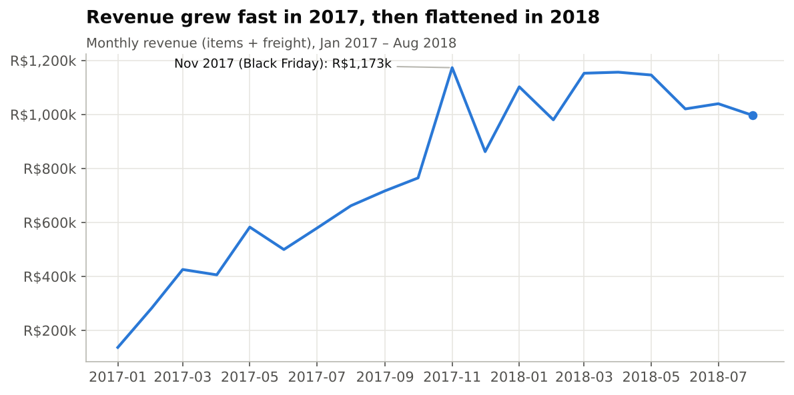
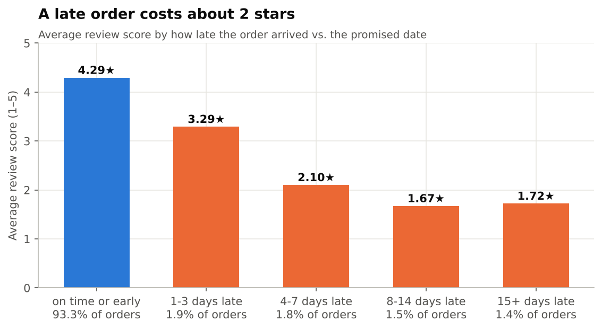
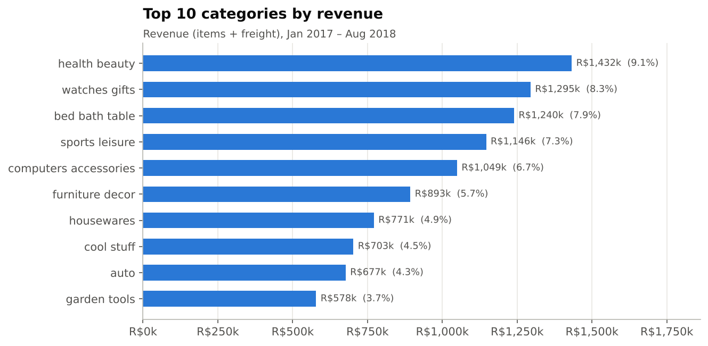
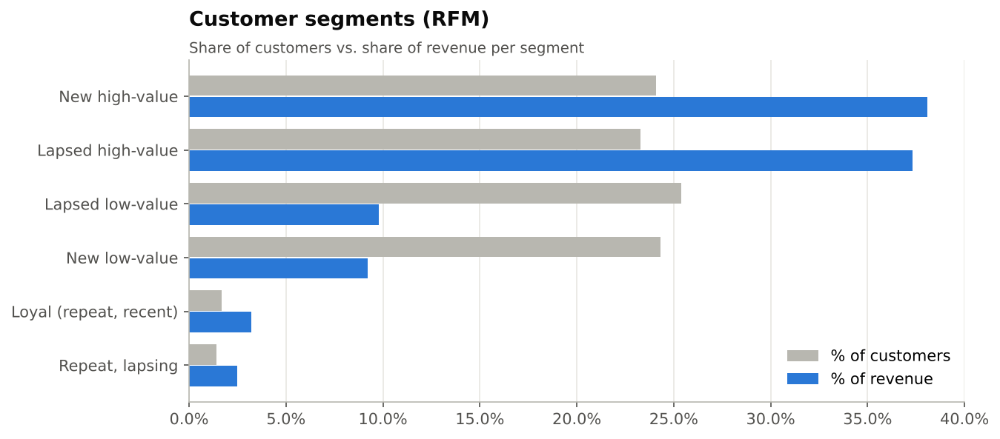

# E-Commerce Analytics: what drives revenue and reviews at Olist

SQL (DuckDB) and Python analysis of **~99,000 real orders** from Olist, a Brazilian e-commerce marketplace,
from January 2017 to August 2018.



## Business questions

1. How fast is the business growing, and what does a typical order look like?
2. Which product categories bring in the most revenue?
3. **Does late delivery hurt customer reviews, and by how much?**
4. Where are deliveries slowest?
5. Do customers come back? Which customer segments matter most (RFM)?

## Key findings

| | |
|---|---|
| **Growth** | Jan–Aug 2018 had **+137% orders** and **+140% revenue** vs. the same months of 2017. Growth stopped in 2018: monthly revenue held at R$1.0–1.15M. |
| **Order value** | Average order value is stable at **~R$160** (items + freight). |
| **Peak day** | **24 Nov 2017 (Black Friday)**: 1,176 orders in one day, about 5× a normal day. |
| **Categories** | Health & beauty (9.1%), watches & gifts (8.3%) and bed/bath/table (7.9%) lead. The top 10 make up 62% of revenue. |
| **Late delivery** | 6.7% of delivered orders arrived late. On-time orders average **4.29★**; orders 4–7 days late average **2.10★**, and **68%** of them get a 1–2★ review. |
| **Regions** | São Paulo gets orders in 8.7 days on average (4.5% late). Northeast states such as Maranhão (21.5 days, 17.5% late) and Ceará are the slowest and get lower reviews. |
| **Retention** | **97% of customers ordered only once.** Repeat customers (3%) bring in 5.7% of revenue. |



### Recommendations

1. **Make delivery promises realistic in the Northeast.** The review drop starts at just 1–3 days late
   (4.29★ → 3.29★). Padding the estimate for slow states, or prioritizing carriers there, protects ratings.
2. **Win the second order.** With 97% one-time buyers, a post-delivery offer aimed at the "New high-value" segment
   (24% of customers, 38% of revenue) is the cheapest growth lever.
3. **Plan capacity for Black Friday.** One day in November created ~5× normal volume.




## Data

[Brazilian E-Commerce Public Dataset by Olist](https://github.com/olist/work-at-olist-data) (CC BY-NC-SA 4.0).
Seven related tables: orders, order items, payments, reviews, customers, products and sellers.

```
customers ──< orders ──< order_items >── products ── category_translation
                 │            └──────── sellers
                 ├──< payments
                 └──< reviews
```

## Method

1. **Model** ([sql/00_build_tables.sql](sql/00_build_tables.sql)): load the CSVs into DuckDB and build
   `fact_orders`, one row per order with revenue, delivery times and the latest review.
2. **Scope:** full months only, Jan 2017 – Aug 2018. 2016 was a test period, and Sep–Oct 2018 have only a few orders.
   Canceled and unavailable orders are excluded from revenue.
3. **Checks** ([01_data_quality.sql](sql/01_data_quality.sql)): no duplicate orders; 739 orders without items
   (canceled/unavailable); some orders have several reviews, so the latest one is used.
4. **Analysis:** one SQL file per question (`sql/02` to `sql/08`), using CTEs, window functions
   (`NTILE`, `ROW_NUMBER`, `SUM() OVER ()`), `QUALIFY` and `CASE` buckets.
5. **RFM:** recency and monetary value are split into quartiles with `NTILE(4)`. Frequency is 1 vs. 2+ orders,
   because almost no one orders more than twice.
6. **Charts:** [analysis.py](analysis.py) runs every query, saves results to `results/*.csv` and draws the charts.

## How to run

```bash
pip install -r requirements.txt
python get_data.py     # downloads the CSVs into data/
python analysis.py     # builds olist.duckdb, prints every result, writes results/ and charts/
```

## Limitations

- Revenue is in Brazilian reais (R$) and is not adjusted for inflation.
- `customer_unique_id` is the only way to link orders to a person, so a customer who used two accounts counts as two.
- Reviews are optional; about 1% of orders have none.
- The analysis shows associations (late orders get worse reviews), not proof of cause.

**Tools:** SQL · DuckDB · Python · pandas · matplotlib
